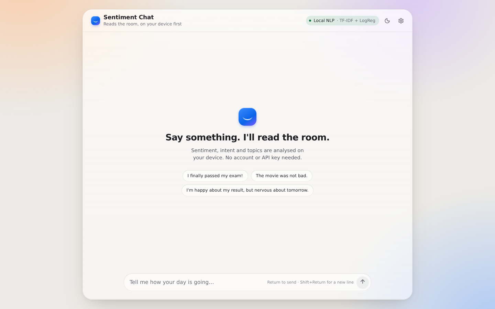
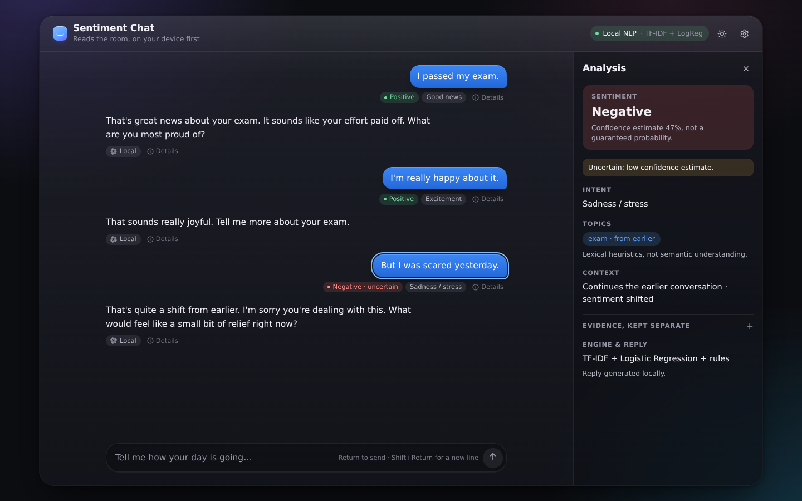
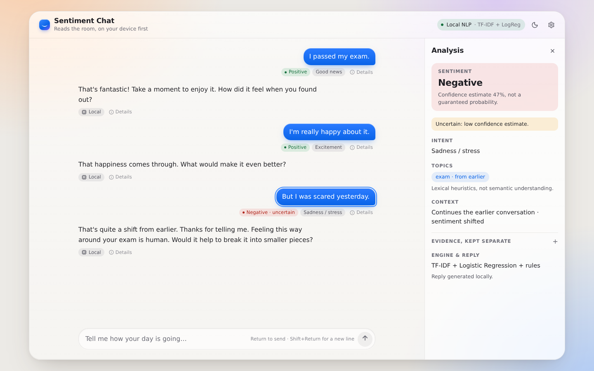
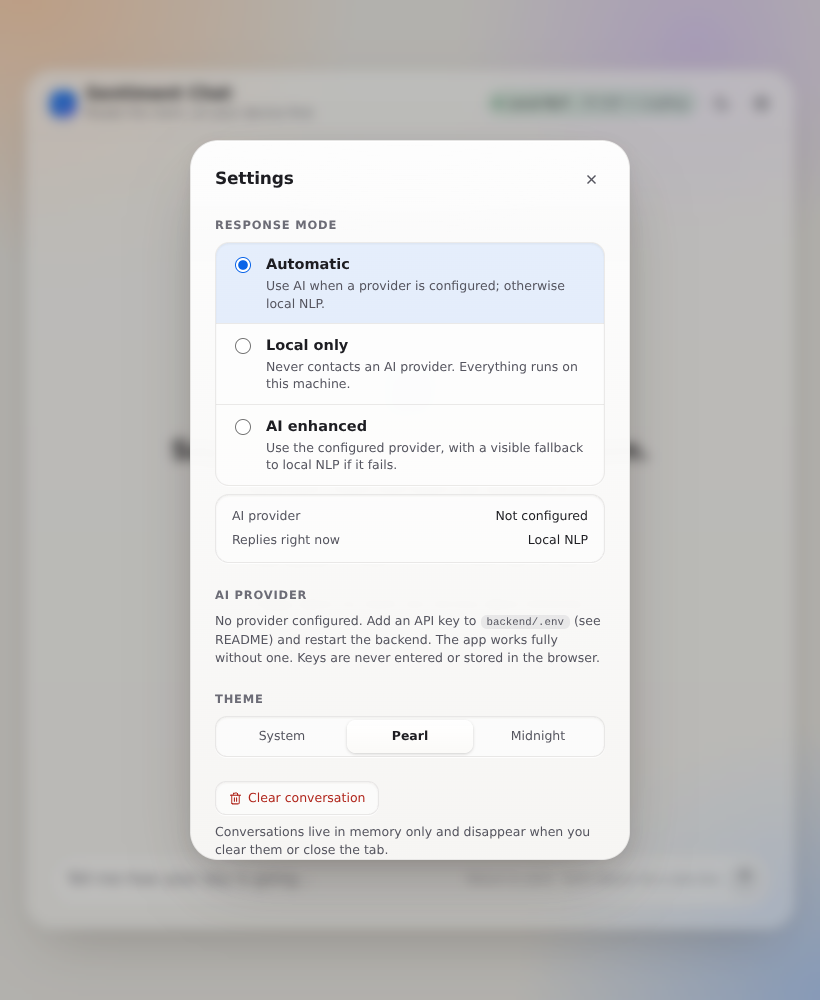
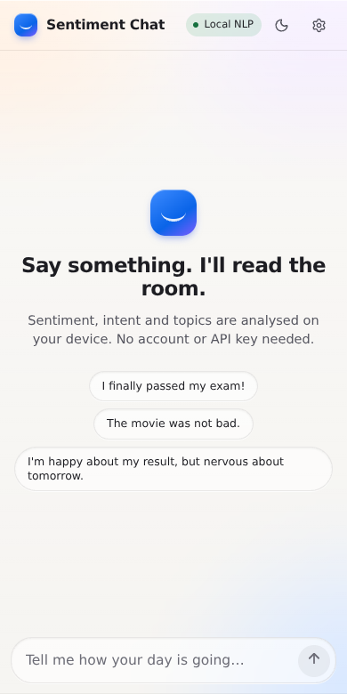
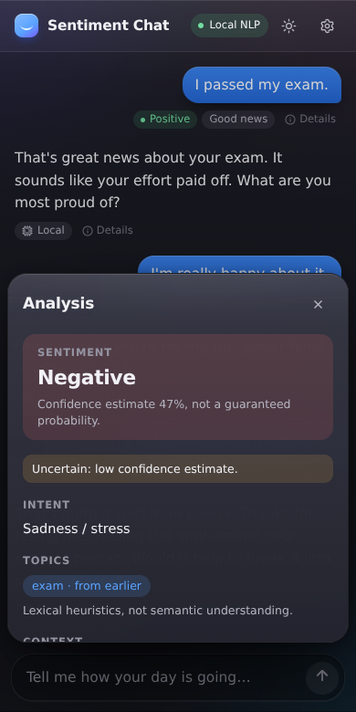

# Sentiment Chat

A local-first chatbot that analyses the **sentiment, intent and topics** of each message and replies, with an Apple-inspired UI (Pearl light / Midnight dark). It works **fully offline with no API key**. An optional AI mode can write the replies when you configure an LLM provider.

> Status: local implementation and verification complete; no Render deployment or live hosted-provider request has been made. See [What was and wasn't verified](#what-was-and-wasnt-verified) for exactly what ran.

## Features
- **Local NLP mode (first-class, no key, no network):** preprocessing (contractions, emoji, negation scopes, elongation), TF-IDF + Logistic Regression classifier, lexicon/rule layer (negation, intensifiers, emoji, contrast words), table-driven intent detection, lexical topic extraction, session context for follow-ups, template-based reply generator with variation.
- **Honest sentiment output:** classifier result and rule result are returned *separately*; the combined label is flagged `mixed` / `uncertain` with reasons. Confidence is a model estimate, not a calibrated probability (calibration error is measured in evaluation).
- **Rules fallback engine:** if no trained model file exists, the app still starts and the UI says "rules fallback".
- **Optional AI mode:** OpenAI-compatible, Anthropic, Groq, Google Gemini, and Ollama adapters (httpx, no vendor SDKs). Keys live only on the backend. Modes: *Automatic*, *Local only* (never calls an LLM), *AI enhanced* (explicit local fallback on any failure).
- **Analytics:** aggregate backend request counts, failures, latency, sentiment, actual reply source/provider, modes, and hourly activity. No message text is retained; metrics live in memory and reset on process restart.
- **UI:** editorial Pearl and smoked-graphite Midnight themes, focused chat column, analysis drawer, provider settings, analytics, offline/error/fallback states, reduced-motion support, keyboard + screen-reader labels.
- **Safety net:** self-harm language gets a fixed, careful reply that is never sent to an LLM.

## Screenshots
The screenshots below are from the earlier UI pass and have not yet been refreshed for the current redesign. Desktop 1440px, tablet 820px, mobile 390px.

| | |
|---|---|
|  |  |
|  |  |
|  |  |

## Architecture
```mermaid
flowchart LR
  UI[React + Vite UI] -->|/api/chat| API[FastAPI routes]
  API --> ORCH[Orchestrator]
  ORCH --> PRE[Preprocessing]
  PRE --> SENT[Sentiment engine\nTF-IDF+LogReg  +  rules]
  PRE --> INT[Intent rules]
  PRE --> TOP[Topic extraction]
  ORCH --> CTX[(In-memory sessions)]
  ORCH -->|mode allows & configured|   LLM[LLM adapter\nOpenAI / Anthropic / Groq / Gemini / Ollama]
  ORCH -->|always available| LOC[Local response templates]
  LLM -. failure / timeout .-> LOC
```
Sentiment, intent and topics are **always computed locally**. The LLM (if used) only writes the reply and receives the analysis as a hint.

```
backend/app/{nlp,conversation,llm,api,schemas,core}   backend/tests   backend/data
frontend/src/{components,hooks,lib,styles,types}
docs/evaluation.md  docs/metrics.json
```

## Requirements
Python 3.11+ (tested 3.12), Node 20+ (tested 22).

## Setup & run
```bash
# Backend (macOS/Linux)
cd backend
python3 -m venv .venv && source .venv/bin/activate     # Windows: .venv\Scripts\activate
pip install -r requirements-dev.txt
python -m app.nlp.training                              # trains the local classifier -> models/sentiment.joblib
uvicorn app.main:app --port 8000

# Frontend (second terminal)
cd frontend
npm install
npm run dev                                             # http://localhost:5173 (proxies /api to :8000)
```
Skip the training step and the app still runs on the rules fallback (the UI shows which engine is active).

### Commands
| Task | Command |
|---|---|
| Rebuild dataset splits | `cd backend && python -m app.nlp.dataset` |
| Train classifier | `cd backend && python -m app.nlp.training` |
| Evaluate (writes `docs/evaluation.md`) | `cd backend && python -m app.nlp.evaluation` |
| Backend tests | `cd backend && python -m pytest` |
| Frontend tests | `cd frontend && npm test` |
| Type check | `cd frontend && npm run typecheck` |
| Production build | `cd frontend && npm run build` |

## Optional AI configuration
```bash
cp backend/.env.example backend/.env    # then edit; never commit .env
```
Set the backend environment variables for the provider you want:

| Provider | Required variables | Model default |
|---|---|---|
| OpenAI-compatible | `OPENAI_API_KEY` (optional `OPENAI_BASE_URL`) | `gpt-4o-mini` |
| Anthropic | `ANTHROPIC_API_KEY` | `claude-sonnet-4-6` |
| Groq | `GROQ_API_KEY` | `llama-3.3-70b-versatile` |
| Google Gemini | `GEMINI_API_KEY` | `gemini-2.5-flash` |
| Ollama | `OLLAMA_BASE_URL`, `OLLAMA_MODEL` | `gemma3:1b` |

Model IDs and availability change: verify the current model catalog for your provider and override the corresponding `*_MODEL` variable when needed. The Groq adapter uses its OpenAI-compatible Chat Completions endpoint; Gemini uses `generateContent`; Ollama uses `/api/chat`. No provider SDK or additional Python package is required. The optional key-based providers require API access from their provider; local-only sentiment and replies remain available without credentials.

For **Render**, add only the selected backend provider's secret key and model setting to the backend Web Service environment (for example `GROQ_API_KEY` + `GROQ_MODEL`). Set `CORS_ORIGINS` to the exact frontend origin(s), comma-separated. For a separately hosted Vite frontend, configure `VITE_API_BASE_URL` at build time to the backend origin, such as `https://your-api.onrender.com` (no path or trailing slash). It is a public URL, not a secret. The default empty value uses same-origin `/api` and works with the local Vite proxy. Never use `VITE_` for keys.

In **Settings → AI provider → Test connection**, select a provider and verify its live connection; "configured" is shown separately from "connection OK". Provider status and safe errors are returned without API keys.

Analytics are aggregate and in-memory, bounded to the most recent 2,000 chat/analysis requests per backend process. They reset on restart/redeploy and are not shared across multiple Render instances. No raw messages or credentials are recorded. Persistent cross-restart or cross-instance analytics are not implemented.

## Data and evaluation
The training set is **small, original and partly synthetic** (template-generated sentences plus short hand-written phrases, `backend/app/nlp/dataset.py`, released under this project's MIT licence). No scraped or private data. Splits are by *group* (a predicate phrase never appears in two splits) with duplicate and leakage assertions. A separate 60-sentence hand-written holdout (`backend/data/handwritten_holdout.csv`) is never used for fitting.

Measured results (`docs/evaluation.md`, produced by the evaluation script):

| Set | System | Accuracy | Macro-F1 |
|---|---|---|---|
| holdout (n=60) | rules only | 0.817 | 0.819 |
| holdout | TF-IDF + LogReg only | 0.683 | 0.680 |
| holdout | combined engine (shipped) | 0.717 | 0.716 |
| test (n=176, synthetic) | rules only | 0.830 | 0.832 |
| test | TF-IDF + LogReg only | 0.614 | 0.635 |
| test | combined engine | 0.716 | 0.728 |

**Honest reading:** with this little training data, the classifier generalises worse than the hand-built lexicon rules, and the validation-chosen blend (classifier weight 0.75) is *worse* than rules alone on both held-out sets. The rules layer was written by the same author as the dataset, so its scores are optimistic for text outside this vocabulary. The classifier will improve with a larger real corpus, and the pipeline is built so you can swap one in. No pretrained transformer was evaluated, so no claim is made about them.

## Limitations
- Sarcasm, irony, idioms, code-mixed text and domain slang are mostly unsupported; vocabulary is English and narrow.
- Topic extraction is lexical (determiner chunks, a keyword list, capitalised names), not semantic.
- Local replies come from templates; they are relevant but not open-ended. Local mode cannot answer factual questions and says so.
- Three-class output simplifies mixed feelings; the `mixed` flag and both evidence lists are shown for that reason.
- `joblib` model files are pickles: only load models you trained yourself.
- This is not a mental-health tool. The self-harm safety reply is a minimal safeguard, not a substitute for professional help.

## Privacy
Conversation context is in server memory only (max 8 turns/session, 500 sessions, 1-hour TTL) and is never written to disk. Raw messages are not logged (only mode, source and length). Analytics stores only aggregate operational measurements and hourly timestamps. In local mode, the backend makes no external AI provider requests. In AI mode your message and a few recent turns go to the provider you configured. Secrets are redacted from logs.

## What was and wasn't verified
Actually run in the current workspace:
- Backend: 100 pytest tests passed using the existing virtual environment (including mocked Groq, Gemini, Ollama, missing credentials, failure and fallback cases). One upstream Starlette/httpx deprecation warning remains.
- Frontend: 16 Vitest tests passed; `npm run typecheck` passed; `npm run build` passed.
- Local browser/API smoke test: local chat returned a reply, Analytics reflected its real request/sentiment/source/latency, and the backend returned the configured CORS origin header.
- Pearl and Midnight, provider settings, and the analytics empty/live states were inspected in the browser. The legacy screenshots above were not refreshed.

Not verified: real Groq, Gemini, Anthropic, OpenAI or Ollama connectivity; Render deployment or production CORS/API URL values; persistent analytics across restarts or multiple backend instances; Safari/Firefox, touch devices, animation feel, or a full manual screen-reader/contrast audit. ESLint is not configured.
